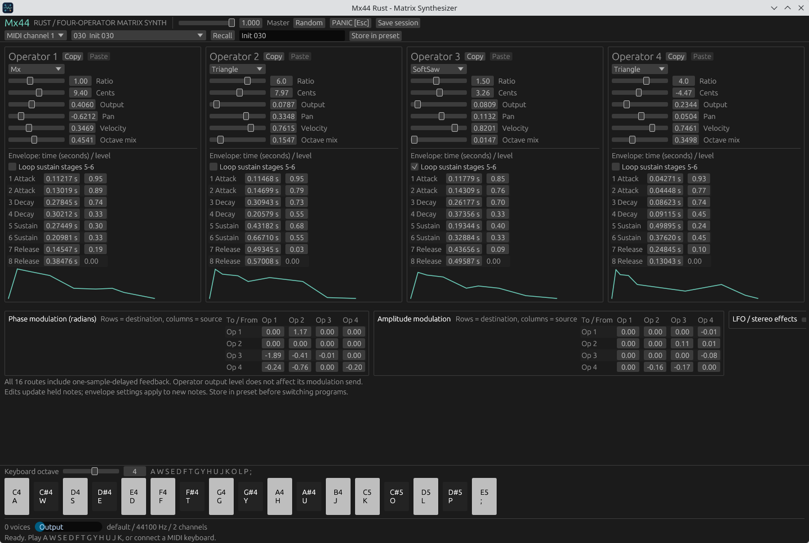

# Mx44 Rust

A four-operator matrix synthesizer inspired by Jens M Andreasen's **Mx44**,
available as a standalone application and VST3/CLAP plugins. It uses a shared
egui editor, portable floating-point DSP, PM/AM modulation, eight-stage
envelopes, stereo effects and 60 factory sounds.

This is a new implementation, not an emulation of the original.



## Installation

Use Rust 1.88 or newer. On Debian/Ubuntu, install the native dependencies:

```sh
sudo apt install build-essential pkg-config libasound2-dev \
  libx11-dev libxi-dev libxkbcommon-dev libwayland-dev libgl1-mesa-dev
```

On Fedora:

```sh
sudo dnf install gcc gcc-c++ pkgconf-pkg-config alsa-lib-devel \
  libX11-devel libXi-devel libxkbcommon-devel wayland-devel mesa-libGL-devel
```

macOS uses CoreAudio/CoreMIDI and requires a Rust toolchain.

```sh
cargo install --path .
```

## Quick start

```sh
mx44-rust
# Or run directly from the source:
cargo run --release
```

Play with a MIDI keyboard or the computer keys **A W S E D F T G Y H U J K**.
Use `mx44-rust --no-midi` for the editor keyboard without a MIDI device.
**Escape / PANIC** stops all voices.

Build VST3 and CLAP plugins with:

```sh
cargo xtask bundle mx44-plugin --release
```

Bundles are written to `target/bundled/`. See the
[plugin installation guide](DOCUMENTATION.md#vst3-and-clap-plugins).

## Documentation

See [DOCUMENTATION.md](DOCUMENTATION.md) for MIDI controls, sessions, preset
importing, rendering, platform setup and development instructions.

The standalone/shared DSP is GPL-2.0-or-later; plugin binaries are
GPL-3.0-or-later. See [attribution and licensing](DOCUMENTATION.md#attribution-and-license).
**Imported preset redistribution permission remains unresolved**; see
[preset licensing](DOCUMENTATION.md#importing-original-mx44-banks).
